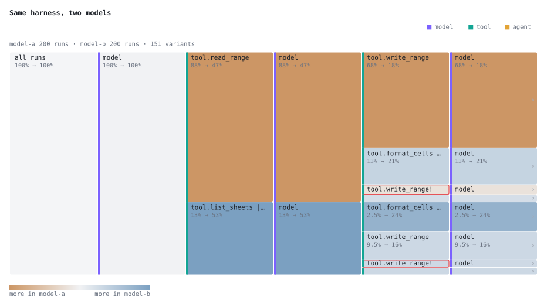

<p align="center"></p>

<h1 align="center">tracegram</h1>

<p align="center">A grammar of agent processes, with declarative views compiled to Vega.<br>
<a href="https://sjoerdvink99.github.io/tracegram/">Documentation</a> · <a href="https://sjoerdvink99.github.io/tracegram/quickstart/">Quickstart</a> · <a href="https://sjoerdvink99.github.io/tracegram/gallery/">Gallery</a> · <a href="https://sjoerdvink99.github.io/tracegram/playground/">Playground</a> · <a href="examples">Examples</a></p>

<p align="center"><a href="https://github.com/sjoerdvink99/tracegram/actions/workflows/ci.yml"></a> <a href="https://www.npmjs.com/package/tracegram"></a> <a href="https://pypi.org/project/tracegram/"></a> <a href="LICENSE"></a></p>

LLM agents run differently every time, so understanding an agent means looking at many of its runs. tracegram is a formal grammar of agent processes, and a declarative view language over it. One syntax writes down a run (a trace), every run a system allows (a design) and a pattern to find in runs (a query). A JSON view spec maps the records your agent already logs to traces in the grammar, and declares how they are abstracted and which of thirteen views to draw: a design as a diagram, one run over time, or the whole corpus, where every view is a defined aggregation of the traces. The view compiles to a [Vega](https://vega.github.io/vega/) spec that renders the same in a browser, in Node, in a notebook or in a paper.

```
records + view spec  →  traces in the grammar  →  abstract, read, count  →  Vega spec  →  figure
```

```bash
npx tracegram report spans.jsonl -o report.html
npx tracegram report logs/model-a.eval logs/model-b.eval
```

writes a linked overview of any corpus in a [standard](https://sjoerdvink99.github.io/tracegram/standards/) format: OpenTelemetry GenAI, OpenInference, LangSmith, Langfuse, Inspect AI, OpenAI, Anthropic and Gemini transcripts, Claude Code, Codex, ATIF, SWE-agent and OpenHands. A folder is one corpus, and two sources are compared. Or drop a file into the [playground](https://sjoerdvink99.github.io/tracegram/playground/): it is read in your browser and never leaves it.

## A view

```jsonl
{"session":"s09","version":"after","type":"llm","start":0.0,"end":1.0}
{"session":"s09","type":"tool","tool":"read","start":1.1,"end":1.5}
{"session":"s09","type":"tool","tool":"write","start":2.5,"end":2.8,"error":"patch did not apply"}
```

```json
{
  "mark": "variants",
  "level": "names",
  "data": { "url": "events.jsonl" },
  "trace": { "run": "session", "actor": "type", "name": "tool", "start": "start", "end": "end", "failed": "error", "group": "version" }
}
```

The `trace` mapping says which field is the run, the actor, the name, the time and the failure. Each session becomes a trace such as `model -> tool.read -> model -> tool.write! -> model`; Vega counts the runs of every distinct trace and compares the two versions.



## Install

```bash
pip install tracegram
pip install "tracegram[save]"
npm install tracegram
```

Import it as `import tracegram` in Python, or from `tracegram` in TypeScript and the browser. The `save` extra writes figures as SVG, PNG and PDF from Python, without Node or a browser.

## Use

```ts
import { compile, embed, render } from "tracegram";

const trace = { run: "session", actor: "type", name: "tool", start: "start", end: "end", failed: "error" };

const svg = await render({ mark: "transitions", data: { url: "events.jsonl" }, trace });

const view = await embed(element, {
  data: { url: "events.jsonl" },
  trace,
  vconcat: [
    { mark: "variants", level: "names", params: [{ name: "picked", select: "click" }], highlight: { param: "picked" } },
    { mark: "sequences", filter: { param: "picked" } },
  ],
});
view.on("select", ({ picked }) => showRuns(picked));

const vega = compile({ mark: "activities", data: { values: events }, trace });
```

In Python, `report` shows the linked overview in a notebook, and a corpus answers questions in the grammar: the share of runs that follow a design, and every place where three tool calls fail in a row.

```python
import tracegram

tracegram.report("spans.jsonl")

runs = tracegram.Corpus(tracegram.read(events, {"run": "session", "actor": "type", "name": "tool", "failed": "error"}))
runs.chart(mark="transitions")
runs.conformance("(model -> tool[])* -> model")
runs.find("(model -> tool!){3,}")
runs.chart(mark="variants", level="names").save("variants.pdf")
```

Agents can do this too: [`skills/tracegram`](skills/tracegram/SKILL.md) is an [Agent Skill](https://docs.claude.com/en/docs/claude-code/skills) that teaches Claude Code and other agents to report on, compare and draw your runs. Copy it into `~/.claude/skills/`.

## The grammar

```
agent loop     (model -> tool[])* -> model
routing        model.route -> (agent.billing | agent.tech | model.answer)
orchestrator   model.plan(=> task:text[]) -> agent.worker{ (model -> tool[])* -> model }[] -> model.synthesize
```

Five actors (`model`, `tool`, `agent`, `human`, `code`), sequence `->` and parallel `||`, each repeated `{m,n}` and `[m,n]`, choice `|`, nested contexts `{…}` and failure `!`. One syntax does three jobs: a **trace** is one run, built from your records; a **design** is every run a system allows, drawn as a `diagram`; a **query** finds patterns in runs and `highlight`s them. See [Grammar](https://sjoerdvink99.github.io/tracegram/grammar/).

## Aggregation

| Step          | Set by                                      |                                                                          |
| ------------- | ------------------------------------------- | ------------------------------------------------------------------------ |
| Abstract      | `transform`, `trace.name`, `level`, `loops` | drop steps, rename them, keep less of each step or of each loop          |
| Read          | the mark                                    | each run's path, its steps, or the pairs of steps that follow each other |
| Count         | the mark, `count`                           | runs, share of runs, steps, or steps per run, within each group          |
| Rank and fold | `limit`                                     | what is drawn, and one remainder that keeps its runs                     |

Every count is defined over the traces, so it means the same in every view, and both test suites check the guarantees that follow: counts roll up across levels, every run conforms to its own abstraction, parallel steps never form a pair, and nothing is dropped. A corpus has one relational form, six [tables](https://sjoerdvink99.github.io/tracegram/tables/), that views, pandas and your own charts read. See [Aggregation](https://sjoerdvink99.github.io/tracegram/aggregation/).

## Views

| Mark                          | Shows                                                                        |
| ----------------------------- | ---------------------------------------------------------------------------- |
| `diagram`                     | a design, written as an expression, as a railroad diagram                    |
| `timeline`                    | when each step of a run ran, per step or per agent                           |
| `handoffs`                    | how control passes between agents and people                                 |
| `icicle`                      | runs merged by shared prefix                                                 |
| `variants`                    | each distinct run, ranked by frequency                                       |
| `transitions`, `graph`        | how often each step directly follows another, as a matrix or a process graph |
| `sankey`                      | how runs flow through their first steps                                      |
| `activities`                  | how often each step occurs and fails                                         |
| `sequences`                   | every run as a row of steps                                                  |
| `distribution`                | how runs spread over their length, failures or duration                      |
| `durations`                   | how long each step takes                                                     |
| `projection`                  | variants placed so that similar runs lie close                               |
| `vconcat`, `hconcat`, `facet` | views stacked, side by side, or one panel per value of a field               |

Each view comes from the agent, event-sequence or process-mining literature. The views fix their encodings, so that linked views read the same way; for anything else, draw the tables with Vega-Lite, Altair or pandas. With two groups of runs, the corpus views show the difference; tooltips, selections, linking and filtering are declared in the spec. See [Views](https://sjoerdvink99.github.io/tracegram/views/).

## How it works

`compile(spec)` returns a self-contained Vega spec. tracegram does what needs the grammar: it maps records to traces, abstracts them, writes the tables, and lays out what must stay put, such as railroad diagrams and the icicle's prefix tree. Everything after that is Vega: each run joins its variant, and counting, ranking and folding are dataflow transforms, so linked views recount as you click. The compiled spec uses no custom functions and runs unchanged in the [Vega Editor](https://vega.github.io/editor/). See [Compiling to Vega](https://sjoerdvink99.github.io/tracegram/vega/).

Exports go the other way: OTLP/JSON, XES, OCEL 2.0, BPMN 2.0 and pm4py process trees.

## Layout

```
grammar/    the contract both languages pass: fixtures, tables, standards, mappings, specs, conventions, the report and the schema
js/         the TypeScript library and CLI, and the only compiler to Vega
python/     the Python package: grammar, corpus analysis, readers, exports, notebook charts
examples/   a TypeScript explorer, a CI report, a plain web page, notebooks, benchmarks
docs/       the documentation site and its playground
skills/     an Agent Skill for writing and rendering views
```

## Cite

If tracegram helps your research, please cite it:

```bibtex
@software{vink2026tracegram,
  author  = {Vink, Sjoerd},
  title   = {tracegram: A Grammar of Agent Processes, with Declarative Views Compiled to Vega},
  year    = {2026},
  version = {0.1.0},
  url     = {https://github.com/sjoerdvink99/tracegram}
}
```

## Contribute

With Node 22+ and Python 3.10+, `make install` sets up both packages and `make check` runs lint, both test suites, the generated files and the examples:

```bash
make install
make check
```

See [CONTRIBUTING.md](CONTRIBUTING.md). Released under the [MIT License](LICENSE).
